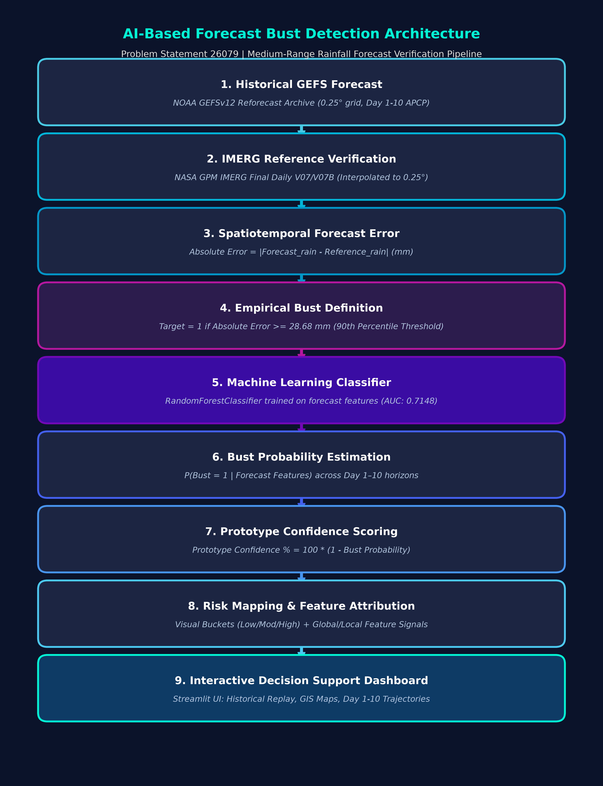

# AI-Based Forecast Bust Detection for Medium-Range Weather Forecasts
### Smart India Hackathon (SIH) | Problem Statement ID: 26079
**Ministry of Earth Sciences (MoES) / IMD / NCMRWF**



---

## 1. Executive Overview
Medium-range Numerical Weather Prediction (NWP) models (Day 1 to Day 10) frequently suffer from localized, catastrophic drop-offs in forecast accuracy known as **"Forecast Busts."** In monsoon precipitation forecasts, an undetected bust severely impacts flood disaster response, water reservoir planning, and agricultural operations.

This system provides an **AI-driven Historical Replay & Decision Support Prototype** that predicts when and where a medium-range rainfall forecast has a high probability of exceeding extreme error thresholds **before** verification observations arrive.

> **Scientific Grounding & Scope Note:**  
> This system is a research prototype evaluated on historical monsoon runs and does **not** claim operational deployment or calibrated probabilities. The reported confidence score is explicitly designated as **"Prototype Confidence"** ($100 \times [1 - P_{\text{bust}}]$).

---

## 2. Project Architecture & Components

```
forecast-bust-prototype/
│
├── backend/                        # FastAPI High-Performance Python Backend
│   ├── main.py                     # API routes, CORS, LightGBM model loader, data serving
│   ├── requirements.txt            # Python dependencies (fastapi, uvicorn, lightgbm, etc.)
│   ├── test_api.py                 # Automated pytest suite (13 integration tests)
│   └── README.md                   # Backend API reference & deployment guide
│
├── frontend/                       # Next.js 16 + React 19 + Tailwind CSS + SWR
│   ├── app/                        # App Router: Home, /replay, /bust-risk
│   ├── components/                 # UI components, GIS map, KPI bar, charts, cards
│   ├── lib/                        # api.ts (REST integration), config.ts, types.ts
│   └── .env.local                  # NEXT_PUBLIC_API_BASE_URL=http://localhost:8000
│
├── model/                          # Machine Learning Artifacts
│   └── final_lightgbm_model.pkl    # Final trained LightGBM Classifier from Kaggle
│
├── data/                           # Kaggle Verification & Evaluation Datasets
│   ├── dashboard_data.csv          # Replay grid data (25,010 samples)
│   ├── final_test_predictions.csv  # Held-out test run predictions (2019-09-01)
│   ├── feature_importance.csv      # Global feature importances
│   ├── shap_importance.csv         # SHAP mean absolute attribution values
│   ├── model_comparison.csv        # LightGBM vs XGBoost validation benchmarks
│   └── model_metadata.json         # Run configurations, threshold, and metrics
│
├── assets/
│   └── architecture.png            # High-resolution system pipeline diagram
│
├── docs/
│   └── methodology.md              # Mathematical formulation and scientific rationale
│
├── requirements.txt                # Root Python dependencies
└── README.md                       # Master Documentation
```

---

## 3. Scientific Methodology & Data Provenance

1. **Forecast Source**: NOAA GEFSv12 (Global Ensemble Forecast System v12) retrospective forecasts ($0.25^\circ \times 0.25^\circ$ grid, Day 1 to Day 10, 24-hour accumulated precipitation).
2. **Ground Truth / Reference Source**: NASA GPM IMERG Final Daily V07/V07B, interpolated onto the GEFS grid using `xarray` linear conservative interpolation.
3. **Prototype Geographical Domain**:
   * Latitude: $18.0^\circ\text{N} - 28.0^\circ\text{N}$
   * Longitude: $75.0^\circ\text{E} - 90.0^\circ\text{E}$
   * Grid dimensions: $41 \times 61 = 2,501$ spatial points.
4. **Bust Definition**: An absolute precipitation forecast error $|F - R| \ge 28.68\text{ mm}$ (the 90th percentile threshold derived from the historical training cohort).
5. **Model Features**:
   * `forecast_rain_mm`: GEFS forecasted precipitation amount (mm).
   * `forecast_change_mm`: Volatility across consecutive lead days ($\Delta F_t$).
   * `spatial_gradient`: Local spatial variability across adjacent grid cells.
   * `lead_day`: Forecast horizon from Day 1 to Day 10.
   * `latitude` & `longitude`: Spatial coordinates capturing regional convective dynamics.

---

## 4. Validated Model Metrics (Kaggle Final LightGBM)

Evaluated strictly on the unseen held-out test run (`2019-09-01 00 UTC`):

| Evaluation Metric | LightGBM Score | Scientific Interpretation |
|---|---|---|
| **ROC-AUC** | **0.7816** | Strong discriminative ability between bust and non-bust events. |
| **PR-AUC** | **0.3271** | Robust baseline under heavy class imbalance (~10% positive bust prevalence). |
| **Brier Score** | **0.1534** | High probabilistic accuracy across all lead days. |
| **Recall** | **0.6409** | **Detects over 64% of extreme forecast busts.** |
| **Precision** | **0.2133** | Operational trade-off tuned to minimize missed severe weather events. |
| **F1 Score** | **0.3200** | Harmonic mean reflecting prototype threshold sensitivity. |

---

## 5. How to Run Locally

### Step 1: Start the FastAPI Backend
```bash
# From the project root
python -m uvicorn backend.main:app --host 0.0.0.0 --port 8000 --reload
```
* Backend runs at: `http://localhost:8000`
* Interactive API Docs: `http://localhost:8000/docs`

### Step 2: Start the Next.js Frontend
```bash
# In a new terminal
cd frontend
pnpm dev
# (or: npm run dev)
```
* Frontend runs at: `http://localhost:3000`
* Environment configuration: `frontend/.env.local` is already configured with:
  ```env
  NEXT_PUBLIC_API_BASE_URL=http://localhost:8000
  NEXT_PUBLIC_USE_MOCK_DATA=false
  ```

---

## 6. Running Backend Verification Tests

Validate all 13 API endpoints, model predictions, and data schemas:
```bash
pytest backend/test_api.py -v
```

---

## 7. Cloud Deployment Guide

### Deploying Backend (FastAPI) on Render / Railway / AWS EC2
1. **Render.com / Railway**:
   * Build Command: `pip install -r backend/requirements.txt`
   * Start Command: `uvicorn backend.main:app --host 0.0.0.0 --port $PORT`
   * Root Directory: `.`
2. Set the public backend URL (e.g. `https://forecast-bust-backend.onrender.com`).

### Deploying Frontend on Vercel
1. Link your GitHub repository in Vercel.
2. Set Root Directory to: `frontend`
3. Add Environment Variable in Vercel Project Settings:
   * `NEXT_PUBLIC_API_BASE_URL` = `https://your-backend-url.onrender.com`
   * `NEXT_PUBLIC_USE_MOCK_DATA` = `false`
4. Click **Deploy**. Vercel will build and host the interactive dashboard globally!

---

## 8. SIH MoES / NCMRWF Roadmap (Beyond Hackathon Prototype)

| Roadmap Milestone | Implementation Plan |
|---|---|
| **Multi-Year Archive Scaling** | Expanding training window from 3 sample runs to 10+ monsoon seasons (2010–2024). |
| **Probability Calibration** | Applying Isotonic Regression or Temperature Scaling on an independent calibration set. |
| **Ensemble Spread Integration** | Ingesting ensemble spread from GEFS 31-member perturbations as an explicit predictor. |
| **NCMRWF Unified Model** | Ingesting NCMRWF NCUM medium-range forecasts alongside GEFS. |
| **Real-Time Operational Pipeline** | Automated cron ingestion of daily 00 UTC NWP cycles with sub-minute bust alerts. |
